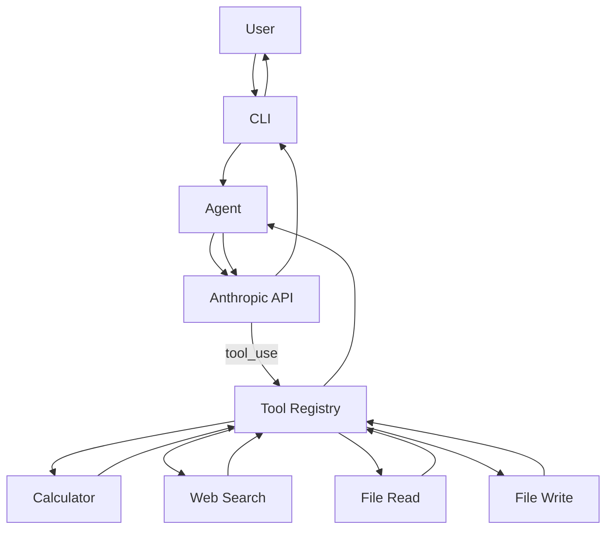

# Multi-Tool AI Agent

A production-style, modular Python AI agent supporting **Groq** (`console.groq.com`) and **Anthropic** with function/tool calling and real-time streaming.

This project demonstrates a real agent architecture rather than a simple wrapper script. Powered by Groq's ultra-fast inference (default model: `openai/gpt-oss-120b`), the agent understands user requests, dynamically selects appropriate tools from an extensible registry, executes them with validated arguments, inspects the tool results, and continues reasoning iteratively until it delivers a grounded final response.

---

## Features

- **Groq & Anthropic Providers**: Seamlessly integrates with Groq's high-speed API (`console.groq.com`) using `openai/gpt-oss-120b` or Claude models via Anthropic tool calling.
- **Real-Time Token Streaming**: Streams generated tokens directly to the terminal as they arrive (`for chunk in completion: print(...)`).
- **Multi-Step Agent Loop**: Handles multi-turn tool calling, including multiple sequential tool steps and parallel tool requests in a single response turn.
- **AST-Based Safe Calculator**: Mathematical evaluator based on Python's Abstract Syntax Tree (`ast.parse`) that securely evaluates arithmetic, parentheses, decimals, and percentages without arbitrary code execution.
- **Sandboxed File Operations**: `file_read` and `file_write` tools strictly sandboxed to a designated `workspace/` directory with path traversal guards.
- **Configurable Web Search**: Search tool supporting Tavily, Brave Search, and DuckDuckGo with structured output (`Title`, `URL`, `Snippet`) and timeout handling.
- **Extensible Tool Registry**: Clean `BaseTool` abstraction and `ToolRegistry` for registering and dispatching tools with JSON schemas (both OpenAI/Groq function format and Anthropic format).
- **Conversation Memory**: Maintains multi-turn context throughout the CLI session, allowing natural references to prior results.
- **Defensive Security Controls**: Rejection of path traversal (`../`), denial-of-service computation limits, secret masking in logs, and tool output size clamping.
- **Interactive CLI**: Terminal interface with session commands (`/help`, `/tools`, `/status`, `/clear`, `/exit`).
- **Comprehensive Offline Test Suite**: 42 unit tests covering all tools and agent loop scenarios using mocked clients, plus optional live API integration tests.


---

## Architecture

The following diagram illustrates how user input travels through the agent, the Anthropic LLM, and the local tool execution pipeline:



### Complete Tool-Calling Lifecycle

1. **User Prompt**: The user enters a question or task into the CLI (e.g., *"Calculate 15% of 2000 and save the answer to result.txt"*).
2. **Context & Tool Assembly**: The `Agent` combines the system prompt, conversation history, and JSON tool schemas from `ToolRegistry.get_schemas()`, then dispatches the request to `LLMClient.create_message()`.
3. **Model Tool Selection**: The Anthropic model examines the tools and responds with one or more `tool_use` blocks (e.g. `calculator(expression="15% of 2000")`).
4. **Local Tool Dispatch**: The `Agent` parses the `tool_use` blocks and delegates execution to `ToolRegistry.execute()`.
   - Arguments are validated.
   - The tool runs locally under strict sandboxing and error boundaries.
   - Results are captured as string outputs (or clear error descriptions).
5. **Tool Result Feedback**: The `Agent` constructs a `user` message turn containing `tool_result` content blocks referencing the corresponding `tool_use_id`.
6. **Reasoning Continuation**: The model inspects the tool results. If subsequent tools are needed (e.g., calling `file_write(path="result.txt", content="300")`), steps 3–5 repeat.
7. **Final Answer Delivery**: When the model has gathered sufficient information, it returns a text message with `stop_reason == "end_turn"`. The agent returns this answer to the user and records the entire interaction in conversation history.
8. **Loop Safety**: A `MAX_TOOL_ITERATIONS` limit (default: 10) prevents runaway loops if the model repeatedly requests tools.

---

## Project Structure

```text
multi-tool-agent/
│
├── pyproject.toml              # Project metadata, build settings, and pytest configuration
├── requirements.txt            # Pinned dependency requirements
├── README.md                   # Comprehensive project documentation
├── .env.example                # Environment variable template
├── .gitignore                  # Git ignore rules (secrets, venvs, caches)
│
├── src/
│   └── multitool_agent/
│       ├── __init__.py         # Package exports (Agent, Settings, ToolRegistry)
│       ├── __main__.py         # CLI runner when invoking `python -m multitool_agent`
│       ├── cli.py              # Interactive terminal CLI with command loop
│       ├── config.py           # Central configuration management via python-dotenv
│       ├── agent.py            # Core agent reasoning loop and conversation management
│       ├── llm.py              # Anthropic SDK client wrapper with error handling
│       ├── models.py           # Dataclasses (ToolCall, ToolResult, AgentStep, AgentResponse)
│       │
│       ├── tools/
│       │   ├── __init__.py     # Tool exports
│       │   ├── base.py         # BaseTool interface and ToolRegistry implementation
│       │   ├── calculator.py   # Safe AST-based arithmetic evaluator
│       │   ├── web_search.py   # Web search tool (Tavily / Brave / DuckDuckGo)
│       │   └── file_tools.py   # Sandboxed FileReadTool and FileWriteTool
│       │
│       └── utils/
│           ├── __init__.py     # Utility exports
│           ├── logging.py      # Sanitized logging with secret scrubbing
│           └── validation.py   # Workspace path sandboxing and security validation
│
├── tests/
│   ├── __init__.py             # Test package root
│   ├── test_config.py          # Configuration and masking tests
│   ├── test_calculator.py      # Arithmetic, percentage, and AST security tests
│   ├── test_file_tools.py      # Sandboxed file read/write, traversal, and size tests
│   ├── test_web_search.py      # Mocked Tavily, Brave, and error scenario tests
│   ├── test_agent.py           # Multi-step loop, parallel tools, and history tests
│   └── test_integration.py     # Optional live Anthropic API integration test
│
└── workspace/
    └── .gitkeep                # Default sandboxed directory for agent file operations
```

---

## Installation

### Prerequisites

- Python 3.11 or newer
- Git

### Linux / macOS

```bash
# 1. Clone repository
git clone https://github.com/yourusername/multi-tool-agent.git
cd multi-tool-agent

# 2. Create and activate a virtual environment
python3 -m venv .venv
source .venv/bin/activate

# 3. Install dependencies and editable package
pip install -r requirements.txt
pip install --no-build-isolation -e .
```

### Windows (PowerShell)

```powershell
# 1. Clone repository
git clone https://github.com/yourusername/multi-tool-agent.git
cd multi-tool-agent

# 2. Create and activate virtual environment
python -m venv .venv
.venv\Scripts\Activate.ps1

# 3. Install dependencies and editable package
pip install -r requirements.txt
pip install --no-build-isolation -e .
```

---

## Configuration

Copy `.env.example` to create your `.env` file:

```bash
cp .env.example .env
```

Configure your credentials in `.env`:

```env
# Groq API Configuration (console.groq.com)
GROQ_API_KEY=your_groq_api_key_here
GROQ_MODEL=openai/gpt-oss-120b

# Search Provider Configuration
SEARCH_API_KEY=your_search_api_key_here
SEARCH_PROVIDER=tavily

# Optional: Switch provider to 'anthropic'
LLM_PROVIDER=groq
# ANTHROPIC_API_KEY=your_anthropic_api_key_here
# ANTHROPIC_MODEL=claude-3-5-sonnet-20241022
```

### Available Environment Variables

| Variable | Default | Description |
| :--- | :--- | :--- |
| `GROQ_API_KEY` | *(required for Groq)* | Groq API secret key (`gsk_...` from `console.groq.com`) |
| `GROQ_MODEL` | `openai/gpt-oss-120b` | Groq model identifier |
| `GROQ_TEMPERATURE` | `1.0` | Sampling temperature |
| `GROQ_MAX_COMPLETION_TOKENS` | `2048` | Maximum output tokens per turn |
| `GROQ_REASONING_EFFORT` | `medium` | Reasoning effort for reasoning models (`medium`, `high`, `low`) |
| `LLM_PROVIDER` | `groq` | Primary LLM provider (`groq` or `anthropic`) |
| `ANTHROPIC_API_KEY` | *(optional)* | Anthropic API key (if using `LLM_PROVIDER=anthropic`) |
| `ANTHROPIC_MODEL` | `claude-3-5-sonnet-20241022` | Anthropic model identifier |
| `SEARCH_API_KEY` | *(optional)* | API key for web search provider |
| `SEARCH_PROVIDER` | `tavily` | Search provider (`tavily`, `brave`, `duckduckgo`) |
| `MAX_TOOL_ITERATIONS` | `10` | Maximum reasoning loop iterations per user query |
| `MAX_FILE_SIZE` | `1048576` (1 MB) | Maximum file size in bytes allowed for `file_read` |
| `MAX_OUTPUT_CHARS` | `8000` | Maximum characters per tool output to prevent context overflow |
| `WORKSPACE_DIR` | `workspace` | Directory path for sandboxed file operations |
| `LOG_LEVEL` | `INFO` | Console logging verbosity (`DEBUG`, `INFO`, `WARNING`, `ERROR`) |


> [!NOTE]
> `.env` is listed in `.gitignore` and must never be committed to source control.

---

## Usage

### Interactive CLI

Launch the agent with the installed console entrypoint:

```bash
multi-agent
```

Or run it as a Python module:

```bash
python -m multitool_agent
```

### CLI Commands

- `/help` — Display available commands and sample prompts.
- `/tools` — Inspect registered tools, parameter schemas, and descriptions.
- `/status` — View current active settings, model, and workspace status (with masked secrets).
- `/clear` — Reset session conversation memory.
- `/exit` or `/quit` — Exit the application.

### Example Conversations

#### Scenario 1: Arithmetic Calculation
```text
You > What is 125 * 17.5 / 100?

  ⚡ Running tool: calculator(expression='125 * 17.5 / 100')
  ✓ Result: 21.875

Agent > 125 * 17.5 / 100 equals 21.875.
```

#### Scenario 2: Web Search
```text
You > Search the web for the latest Python release.

  ⚡ Running tool: web_search(query='latest Python release')
  ✓ Result: Search results for 'latest Python release'...

Agent > The latest Python release is Python 3.13.x (with Python 3.14 currently in active development).
```

#### Scenario 3: Sandboxed File Reading
```text
You > Read workspace/notes.txt and summarize it.

  ⚡ Running tool: file_read(path='notes.txt')
  ✓ Result: - Finalize project architecture...

Agent > Here is a summary of notes.txt:
1. Finalize project architecture.
2. Complete tool sandboxing and unit tests.
3. Prepare documentation.
```

#### Scenario 4: Chained Calculation and File Writing
```text
You > Calculate 15% of 2000 and save the answer to result.txt.

  ⚡ Running tool: calculator(expression='15% of 2000')
  ✓ Result: 300
  ⚡ Running tool: file_write(content='300', path='result.txt')
  ✓ Result: Successfully wrote 3 characters to workspace/result.txt

Agent > 15% of 2,000 is 300. I have saved the result to workspace/result.txt.
```

#### Scenario 5: Multi-Turn Conversation Memory
```text
You > What is 25 * 20?

  ⚡ Running tool: calculator(expression='25 * 20')
  ✓ Result: 500

Agent > 25 * 20 is 500.

You > Now calculate 10% of that.

  ⚡ Running tool: calculator(expression='10% of 500')
  ✓ Result: 50

Agent > 10% of 500 is 50.
```

---

## Testing

The test suite is built with `pytest` and runs **100% offline** without requiring any live API keys.

### Run Standard Offline Test Suite

```bash
pytest
```

For verbose output:

```bash
pytest -v
```

### Test Coverage Overview

- **Calculator Tests (`test_calculator.py`)**: Validates standard arithmetic (`+`, `-`, `*`, `/`, `//`, `%`, `**`), decimals, unary operators, percentages (`15% of 2000`, `17.5% * 850`), syntax error handling, division/modulo by zero, exponential DOS guards (`2 ** 100000`), and strict rejection of arbitrary Python syntax (`import`, `open`, `eval`, `__class__`, variable lookups).
- **File Tool Tests (`test_file_tools.py`)**: Tests reading and writing using `tmp_path`, directory creation, file overwrites, oversized file guards, and path traversal rejection (`../../etc/passwd`, `/etc/passwd`).
- **Web Search Tests (`test_web_search.py`)**: Validates Tavily and Brave response formatting, empty query validation, HTTP 401 unauthorized errors, HTTP 429 rate limits, HTTP 500 server errors, and connection timeouts using mocked HTTP transports.
- **Agent Loop Tests (`test_agent.py`)**: Tests direct text responses, single tool calls, sequential multi-turn tool calling, parallel tool execution within a single turn, unknown tool recovery, tool execution errors, iteration limit exhaustion (`MAX_TOOL_ITERATIONS`), and conversation history preservation across consecutive turns.
- **Config Tests (`test_config.py`)**: Tests default parameters, environment variable overrides, secret masking, and directory resolution.

### Running Live Integration Tests (Optional)

To run live end-to-end tests against the Anthropic API (requires a valid `ANTHROPIC_API_KEY` in `.env`):

```bash
pytest -m integration -v
```

Standard `pytest` runs automatically exclude integration tests via `addopts = "-m 'not integration'"` in `pyproject.toml`.

---

## Security Model

Security is a primary design goal of this agent:

1. **AST-Based Calculator**:
   - Never evaluates arbitrary expressions with Python's unsafe `eval()`.
   - Parses expressions into Abstract Syntax Trees using `ast.parse(expr, mode='eval')`.
   - Whitelists only safe numerical constants and arithmetic binary/unary operators.
   - Restricts exponent values (`MAX_EXPONENT_VALUE = 1000`) to prevent computational denial-of-service.
2. **Workspace Sandboxing**:
   - `file_read` and `file_write` resolve all paths against `WORKSPACE_DIR`.
   - Uses `pathlib.Path.resolve()` and `relative_to()` to strictly verify that target paths cannot escape the sandbox directory.
   - Prevents path traversal via `../` or absolute root paths (`/etc/passwd`, `C:\Windows`).
3. **API Key & Secret Isolation**:
   - Environment variables loaded exclusively via `python-dotenv`.
   - Secrets are masked (`sk-...def`) in status outputs, logs, and exception messages.
   - Custom `SanitizedFormatter` scrubs secret patterns matching Anthropic and Tavily key formats from application logs.
4. **Context Flooding Protection**:
   - `MAX_FILE_SIZE` prevents accidentally loading large files into the LLM context.
   - `MAX_OUTPUT_CHARS` truncates large tool results before passing them back to the LLM.
5. **Loop Runaway Prevention**:
   - `MAX_TOOL_ITERATIONS` caps consecutive tool execution turns, failing gracefully if the model loops without finalizing.

---

## Future Improvements

- **Streaming Responses**: Support Anthropic streaming events to stream tool progress and token output to the CLI in real time.
- **Persistent Memory**: SQLite or JSON-based session persistence across terminal restarts.
- **Model Context Protocol (MCP)**: Add an MCP client adapter to automatically discover and connect to external MCP servers.
- **Async Execution**: Enable asynchronous parallel tool execution (`asyncio`) for concurrent web queries and file writes.
- **Human-in-the-Loop Confirmation**: Add interactive approval prompts for destructive operations (e.g., file overwrites or deletes).
- **FastAPI / REST API Service**: Expose the agent via a web service with OpenAPI documentation and WebSocket streaming.
- **Rich Web UI**: Modern web frontend built with dynamic chat streaming and tool activity visualizations.
- **OpenTelemetry Observability**: Distributed tracing for tool latency, token usage, and LLM call inspection.
